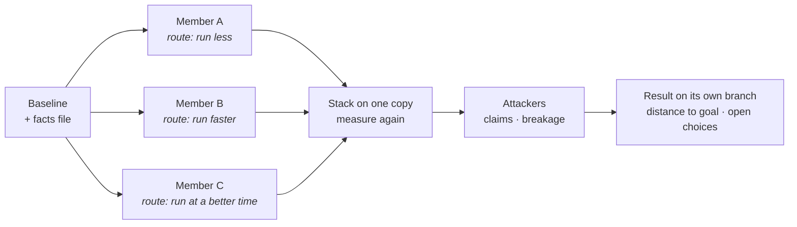

<div align="center">

# council-testing

**Several builders, several routes, one measured goal. Stack what works, measure again, then try to break it.**

A skill for Claude Code and other agents that load `SKILL.md` skills.


[Overview](#overview) · [How it works](#how-it-works) · [Quick start](#quick-start) · [The helper script](#the-helper-script) · [Design principles](#design-principles) · [FAQ](#faq)

</div>

---

## Overview

Most improvement happens by "the same, a little better". That loop is
useful and it has a ceiling, because it never leaves the shape it started
in.

`council-testing` is for getting past that ceiling. It gives several
capable agents their own private copy of your project, one shared goal
expressed as a number, and a different **route** to it each. They build,
run and measure. The orchestrating agent then stacks the working results on
one copy, measures the whole again, and sends **attackers** who built none
of it to break it.

What comes back is not an opinion. It is working change on a branch, a
before-and-after number, and an honest account of how far the goal still
is.

> [!NOTE]
> This README describes the design for people. Agents run from
> [`SKILL.md`](../../council-testing/SKILL.md). Council members are never pointed at this file.
> See [Why the design is hidden](#why-the-design-is-hidden).

## When to use it

| You need | Reach for |
|---|---|
| A fact about the project | A command |
| An edit, a survey, a reading | A single agent |
| Different ways of *thinking* about a subject | A panel: [`panel-review`](../panel-review/README.md) |
| **Different ways of building toward one measured goal** | **A council** |

Good subjects for a council:

- a hard optimisation with a number attached: speed, cost, size, pass rate,
  error count, accuracy;
- a suspicion that a fundamentally different approach exists, when small
  steps have stopped paying.

A council can start from anything: an idea, a measurement, a failure,
research. A panel is one good starting point, and it feeds a council only
through its synthesis.

## How it works



1. **Fix the goal and the measure.** One number with a guard clause; one
   command that prints it. Members cannot change the measure.
2. **Run the baseline alone** and find where the number comes from.
3. **Draw routes** far enough apart not to duplicate, wide enough to
   explore.
4. **Create a private worktree per member** and write the briefs.
5. **Members work alone.** Each may request research and continue, or stop
   with evidence of why.
6. **Stack and measure again.** Gains from different routes do not simply
   add.
7. **Stress round.** Attackers on separate ground try to break the
   combined result. Real problems are fixed; harmless rarities are
   recorded.
8. **Report.** The result stays on its own branch for the owner to merge.

## Quick start

Copy the `council-testing` folder into your skills directory:

```bash
cp -r council-testing ~/.claude/skills/
```

Then ask for a council in plain words:

```text
Run a council on the test suite. Goal: under 60 seconds from 240,
with every case still checked.
```

or chain it from a panel:

```text
Panel the import pipeline, then council whatever comes out of it.
```

Before dispatch the agent shows you the goal, the measure, the routes and
the expected cost. It comes back with a numbered report:

| Section | Contains |
|---|---|
| Result | Before and after on the measure, the goal, the distance left and what blocks it |
| Routes | What each added in the stack; what was kept, dropped or taken in part |
| Stress round | What broke, what was fixed, what was recorded and left |
| Trust | How far to rely on the number, when the measure was indirect |
| Open choices | Options, with a recommendation |
| Cost | Tokens or money, wall time, model and effort, any limit reached |

## The helper script

`scripts/council.py` does the mechanical work, so no agent spends judgement
on it. It needs Python 3 and git, and nothing else.

```bash
python scripts/council.py new suite --members less,faster,timing \
    --measure "python tools/time_suite.py" --protect "tools/time_suite.py"
python scripts/council.py status suite
python scripts/council.py integrate suite --order less,faster,timing --each
python scripts/council.py add suite attack-claims
python scripts/council.py close suite
```

| Command | What it does |
|---|---|
| `new` | One worktree per member, plus `combined`, beside the project |
| `add` | A further copy, by default from `combined`; used for attackers |
| `status` | Commits and files per member, files touched by more than one, and whether the combined copy has a final number |
| `measure` | Runs the measure in any copy, or in all of them, and records the result with the commit, the machine load and any measure file that changed |
| `integrate` | Stacks members in order, stops cleanly on a conflict, then measures |
| `close` | Removes the copies and keeps the branches |

`integrate` refuses a member that changed a protected measure file. Every
measurement also reports a protected file that differs from the base, in
the copy or in the project itself, and a machine whose load is above its
core count. Give `--protect` once for each glob. A project that is not a
git repository is copied and committed first.

## Design principles

**One goal, several routes.**
Every member owns the same number and goes after it a different way.
Different chores with no shared number is a work queue.

**A goal set beyond what looks reachable.**
A comfortable target is met by the first good idea, and the work stops. A
far one keeps a capable builder searching past the obvious, which is where
a different way of doing the thing is found.

**Falling short is a normal outcome.**
The distance left, and what blocks it, is part of the result and is
reported plainly.

**Evidence is a measurement.**
A claim with no before and after is not a result. The measure is fixed
first, the same for everyone, and protected from the members.

**Members are aimed, not bent.**
A route tells a capable generalist where to dig. It never tells it what to
ignore, because what it hands back has to work as a whole.

**Builders do not certify their own work.**
Builders test what they meant to build, so their tests pass. Attackers
look for what the builders did not mean.

**Strict about honesty, generous about method.**
The measure, the guard and the evidence rules are firm. How a member works
inside its route is its own business, including leaving the expected
method for a better one.

## Defaults

| Setting | Default | Changed by |
|---|---|---|
| Members | 3 (2 to 5 by subject size) | The orchestrator, stated up front; more than 5 by the owner |
| Attackers | 2, on separate ground | A third for a large change; more by the owner |
| Model and effort | Opus, medium | The owner |
| Integrator | Sonnet, only on a conflict | — |
| Limits | A loop detector, in the unit that fits the project | The orchestrator, stated up front |
| Who starts a council | The owner | The orchestrator may propose one |
| Where the result lands | Branch `council/NAME/combined` | Merged only by the owner |

## Measuring hard subjects

When no direct number exists, [`references/measures.md`](../../council-testing/references/measures.md)
describes four substitutes and the ways each can mislead:

| Measure | Example |
|---|---|
| Proxy number | Questions from a fixed list that a help page fails to answer |
| Fixed case set | Forty awkward inputs a parser must handle |
| Blind graders | Fresh reviewers scoring unlabelled results against one rubric |
| Replay | Would this rule have caught the last fifty real incidents? |

The less direct the measure, the more the owner is told before the start.

## Why the design is hidden

A member that learns the goal was set out of reach on purpose stops at the
first respectable gain. So:

- members are told the goal is hard and can be reached, which the method
  has earned more than once;
- briefs never describe the design and never name this skill;
- the skill's public `description` says only "hard".

No fact is misstated to a member, and nothing is withheld from the owner.
If you fork this skill, keep the frontmatter `description` free of the
design, and do not name this README or `PHILOSOPHY.md` in a brief.

## FAQ

<details>
<summary><b>What if the goal is not reached?</b></summary>

That is the common case, and it is not a failure. The report gives the
gain achieved, the distance left and what blocks it. In the project this
skill came from, most councils missed their goal and still landed
substantial improvements.
</details>

<details>
<summary><b>Will it change my working branch?</b></summary>

No. Members work in separate worktrees on their own branches. The combined
result stays on `council/NAME/combined` until you merge it.
</details>

<details>
<summary><b>How much does it cost?</b></summary>

It depends on the measure and the subject, and the agent states an
expected cost before dispatch. The largest cost is a slow measure run many
times by every member, which is why the skill pushes for a fast one.
</details>

<details>
<summary><b>How is this different from a panel?</b></summary>

A panel's reviewers are read-only and deliberately one-sided; they produce
ideas. A council's members are capable generalists with write access to a
private copy; they produce working, measured change.
</details>

<details>
<summary><b>What stops a member from gaming the number?</b></summary>

The guard clause on the goal, the protected measure files (changed ones are
reported at every measurement), the requirement
of a before and after on every claim, and the attackers, one of whom
exists only to test whether the reported numbers are true.
</details>

## Repository layout

```text
council-testing/
├── SKILL.md                      procedure the orchestrator follows
├── references/
│   ├── brief-templates.md        member, continuation, attacker, integrator
│   ├── measures.md               measures for hard subjects, with pitfalls
│   └── origins.md                the incident behind each rule
└── scripts/council.py            copies, status, measure, integrate, close
```

## Status

One council has run from the skill on real work, and the skill and the
script were changed from what it showed. No council has run from the
changed text yet. The script's checks are in
[`test_council.py`](test_council.py).

## Related

- [`panel-review`](../panel-review/README.md): the companion skill for thinking and
  review.
- [`PHILOSOPHY.md`](PHILOSOPHY.md): why the skill is shaped this way, and
  how to change it without breaking it.

## Licence

MIT. See [`LICENSE`](../../LICENSE).
