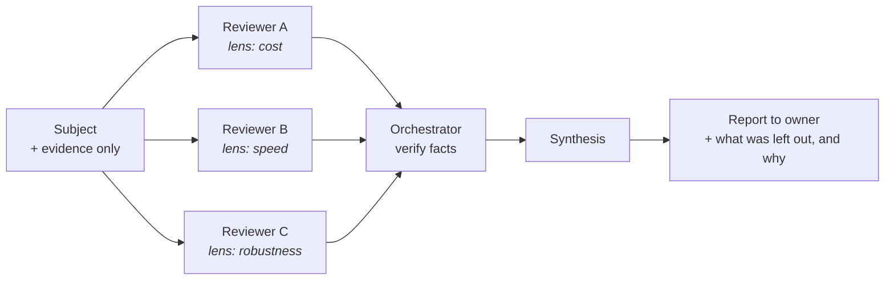

<div align="center">

# panel-review

**Three reviewers who are made to think differently, and one synthesis that is better than any of them.**

A skill for Claude Code and other agents that load `SKILL.md` skills.


[Overview](#overview) · [How it works](#how-it-works) · [Quick start](#quick-start) · [Design principles](#design-principles) · [FAQ](#faq)

</div>

---

## Overview

Ask three capable models the same question and you usually get one answer
three times. They share their training, so they share their blind spots.

`panel-review` breaks that on purpose. It gives each of three read-only
reviewers a different **lens**, a premise held above all others, strong
enough to push the reviewer out of the common answer. The orchestrating
agent then checks their facts and **synthesises**: it takes the strongest
part of each report, trims what does not hold, and looks for the moment
when one reviewer's discarded idea solves another reviewer's problem.

The result is not a vote and not the overlap. It is something none of the
three wrote.

> [!NOTE]
> This README describes the design for people. Agents run from
> [`SKILL.md`](../../panel-review/SKILL.md). Reviewers on a panel are never pointed at this
> file. See [Why the design is hidden](#why-the-design-is-hidden).

## When to use it

| You need | Reach for |
|---|---|
| A fact about the project | A command |
| One specific check | A single reviewer |
| **Different ways of thinking about one subject** | **A panel** |
| Different ways of *building* toward a measured goal | A council: [`council-testing`](../council-testing/README.md) |

Good subjects for a panel:

- a design or plan that is expensive to get wrong;
- a problem that is stuck, or where every proposed solution looks like the
  last one;
- finished work that needs adversarial review before it is trusted;
- a search for a new approach when step-by-step improvement has stopped
  paying.

A panel thinks. It never edits, builds or patches.

## How it works



1. **Choose three lenses** that are far apart and that all serve the goal.
2. **Prepare evidence.** Paths, output, figures. No hypothesis and no
   preferred answer. Check the instrument against the real thing first.
3. **Brief each reviewer.** Same body, different lens.
4. **Dispatch all three at once**, read-only, and show the owner the goal
   and each lens with its expected headline.
5. **Verify** the facts the reports stand on.
6. **Synthesise**, and record what was left out and what would have made
   it work.
7. **Optionally, one more round** when a proved discovery, from a lens, the
   orchestrator or the owner, could set off new ideas in the lenses.
8. **Report** in chat and save the pack, the briefs, the reports, the
   synthesis and process notes.

## Quick start

Copy the `panel-review` folder into your skills directory:

```bash
cp -r panel-review ~/.claude/skills/
```

Optionally install the read-only reviewer agent type, so it exists before a
session starts:

```bash
python ~/.claude/skills/panel-review/scripts/install_reviewer.py
```

Then ask for a panel in plain words:

```text
Panel this caching design. Lenses: cost, cold-start latency, operability.
```

or leave the lenses to the agent:

```text
Run the panel on docs/plan.md. I want to know what we are not seeing.
```

At dispatch the agent tells you the goal as it understood it, the three
lenses and the expected cost. It comes back with a numbered report:

| Section | Contains |
|---|---|
| Synthesis | The combined result, and which lens each part came from |
| Verified | The facts it stands on, each with its command |
| Left out | Ideas not used, why, and what would have to be true for each to work |
| Open choices | Tensions it could not resolve, with a recommendation |
| Next | Actions, cheapest first |
| Cost | Tokens or money, model and effort |
| If it should be built | A goal number, a measure and routes, ready for a council |

## Design principles

**Synthesis, not consensus.**
Agreement between reviewers is evidence, never the goal. A result that all
three would sign is usually the average, and the average was available
without a panel.

**Distance between lenses is the fuel.**
Three similar reports cannot be combined into something better than one of
them. The round is won or lost when the lenses are chosen.

**A reviewer is lopsided by design.**
It trades general balance for a specialist's reach. That makes it a good
source and a poor builder, so a reviewer never implements.

**Evidence in, conclusions out.**
A hypothesis written into a brief comes back three times. Reviewers receive
evidence and a goal, never the orchestrator's theory.

**Facts are verified; ideas are given room.**
A factual claim carries its command. An idea may be speculative when it is
labelled as one, and is scored by its payoff separately from its odds, so
that a long shot survives.

**The orchestrator is the weakest point.**
It did not leave the common answer; the reviewers did. Before it drops an
idea it must say what would have to be true for the idea to work, and it
names the strangest idea it kept and the strangest it dropped.

## Defaults

| Setting | Default | Changed by |
|---|---|---|
| Reviewers | 3 (always an odd number) | The owner |
| Model | Sonnet | The owner only |
| Effort | High | The orchestrator may raise it, and says so |
| Rounds | 1 | One further round on a proved discovery |
| Who starts a panel | The owner | The orchestrator may propose one |
| Reviewer access | Read-only, shell allowed for checks | Not configurable |

## Why the design is hidden

A reviewer that learns its lens may be the doubtful one, or that its report
will be trimmed and combined, stops pushing. So:

- the skill's public `description` says nothing about how reports are used;
- every brief names the skills a reviewer may load;
- reviewers read inside the project under review, not inside this folder.

If you fork this skill, keep the frontmatter `description` free of the
design, and do not name this README or `PHILOSOPHY.md` in a brief.

## FAQ

<details>
<summary><b>Why not a stronger model?</b></summary>

The value comes from the difference between the reviewers, not from the
power of each. Most findings are textual and checkable, and a cheaper model
finds them at a fraction of the cost. A stronger model is available when
the owner asks for it.
</details>

<details>
<summary><b>Why three?</b></summary>

Three produces real disagreement without becoming a committee, and an odd
count gives a tiebreak when the reviewers split on a basic assumption. Five
is possible at the owner's word.
</details>

<details>
<summary><b>What if all three reports say the same thing?</b></summary>

Then the lenses were too close, and the report says so. Overlap is not
presented as confirmation.
</details>

<details>
<summary><b>How is this different from a council?</b></summary>

A panel thinks differently. A council does differently: its members are
capable generalists who build and measure in private copies of the project.
A panel's synthesis is a good starting point for a council.
</details>

<details>
<summary><b>Can a panel change my files?</b></summary>

No. Reviewers have no edit or write tool when the bundled agent type is
installed, and are instructed read-only in every case. They keep a shell,
so that they can run checks.
</details>

## Repository layout

```text
panel-review/
├── SKILL.md                      procedure the orchestrator follows
├── references/
│   ├── brief-template.md         reviewer briefs, including the second round
│   ├── variants.md               graded rubrics, research-then-resume, disjoint panels
│   └── origins.md                the incident behind each rule
├── assets/panel-reviewer.md      read-only reviewer agent definition
└── scripts/install_reviewer.py   installs that definition
```

## Status

Three panels have run from the skill on real work, and the skill was
changed from what they showed. The second round, graded rubrics and
research-then-resume have not run yet.

## Related

- [`council-testing`](../council-testing/README.md): the companion skill for building
  and measuring.
- [`PHILOSOPHY.md`](PHILOSOPHY.md): why the skill is shaped this way, and
  how to change it without breaking it.

## Licence

MIT. See [`LICENSE`](../../LICENSE).
